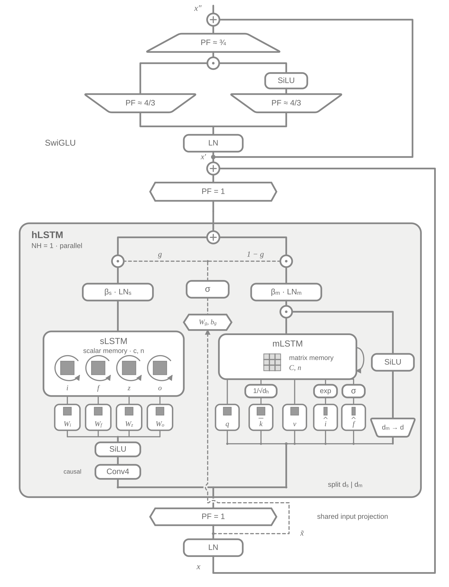
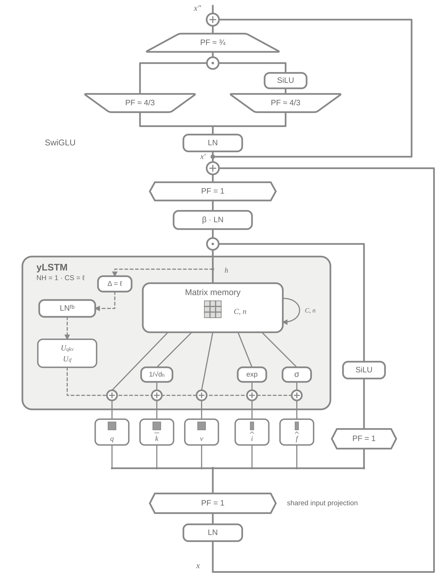

# hybrid-xlstm

Training code, saved metrics, and figures for *Hybrid xLSTM: Recurrence and Linear Attention at the Block and Cell Level*. The manuscript is [hybrid-xlstm-thesis.pdf](hybrid-xlstm-thesis.pdf).

hLSTM runs an sLSTM branch and an mLSTM branch in parallel inside one block.



yLSTM places the yLSTM cell in the single-branch hLSTM block.



Other architecture names are listed in [experiments/ylstm_architecture/README.md](experiments/ylstm_architecture/README.md).

## Install

These commands need Python 3.10 or newer.

```bash
python -m venv .venv
source .venv/bin/activate
pip install -r requirements.txt
```

That install is enough to train on CPU or MPS. `slstm`, `mlstm`, and `xlstm` import the CUDA package `xlstm`. A Mamba run uses `mamba-ssm` when that kernel imports, and otherwise uses `mambapy`. Install the CUDA packages before those runs:

```bash
export CUDA_HOME=$CONDA_PREFIX   # directory that contains nvcc
pip install -r ml/requirements-cuda.txt --no-build-isolation
```

Install Weights & Biases only when using `--wandb`:

```bash
pip install -r ml/requirements-wandb.txt
```

## Train

Suite and setup runs are written under `runs/`. Archived metrics stay in `experiments/`.

One reported config:

```bash
python -m ml train \
  -c experiments/ylstm_architecture/20261005_testeval_disjoint_a/setup/chomsky/regular/hlstm_parity_check_s728572034.yaml \
  -o runs
```

A study, one model, one task, or the full confirmation roster (five seeds, disjoint train/val/test). Training stops when validation sequence accuracy reaches 0.95, and otherwise runs for 128 epochs:

```bash
python -m ml train --suite headline -o runs
python -m ml train --suite all --model hlstm -o runs
python -m ml train --suite all --task parity_check -o runs
python -m ml train --suite all -o runs
```

| Suite | What it trains |
|---|---|
| `headline` | Transformer, Mamba, sLSTM, mLSTM, xLSTM, hLSTM, yLSTM in the hLSTM block, and xLSTM in the hLSTM block |
| `cells` | LSTM, GRU, and the bare sLSTM, mLSTM, and yLSTM stacks |
| `cross` | yLSTM in the hLSTM, sLSTM, and mLSTM blocks, plus the standard-cell controls |
| `chunk` | yLSTM at chunk sizes T, 1, 2, 4, and 8 |
| `all` | Every confirmation config |

`--model` and `--task` take comma-separated names, for example `--model hlstm,ylstm --task parity_check,mqar`. `--setup DIR` trains the run YAMLs in any other experiment directory, including a learning-rate grid. `all` does not include learning-rate grids.

## Figures

```bash
python scripts/build_figures.py
```

Plots are written to `figures/plots/` and tables to `figures/tables/`. Both directories are generated from the saved metrics.

## License

Code, experiment configuration, and saved metrics are under the Apache License, Version 2.0. See [LICENSE](LICENSE) and [NOTICE](NOTICE).

Files under `ml/tasks/chomsky_hierarchy/` that carry a DeepMind copyright header stay under that copyright and the Apache License, Version 2.0. Fonts in `assets/fonts/` are under the SIL Open Font License. The manuscript `hybrid-xlstm-thesis.pdf` is licensed under the terms of its official publication at Johannes Kepler University Linz.
